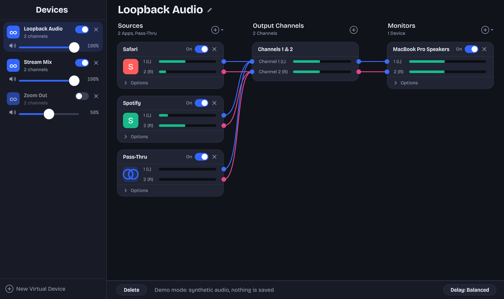
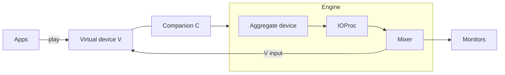

# SoundRouter

An open-source alternative to Loopback and Soundflower for macOS, written in Rust, with a native-feeling GUI. Create virtual audio devices, then route apps, microphones and monitors between them on a node graph.




## Features

- Virtual devices through an AudioServerPlugIn (HAL) driver.
- Node-graph routing UI.
- Per-app capture via CoreAudio process taps.
- Physical input and monitor routing.
- Level meters and pass-thru.

## Architecture

| Crate | Role |
|-------|------|
| `sr-core` | Shared types and frozen contracts (config, graph, backend trait). |
| `sr-audio` | CoreAudio engine: taps, aggregate device, IOProc, mixer. |
| `sr-cli` | Command-line control of the engine. |
| `driver` | AudioServerPlugIn cdylib that publishes the virtual devices. |
| `app` | eframe GUI (`SoundRouter`). |



Apps play into a virtual device; a hidden companion device joins the engine's aggregate, whose IOProc feeds the mixer. The mixer writes back to the virtual device's input and to physical monitors. Full design: [docs/PLAN.md](docs/PLAN.md).

## Status

Verified:
- Unit tests across the workspace.
- The driver passes a fake-host harness.
- The GUI runs against a demo backend (`--demo`).

Not yet verified:
- The driver running inside `coreaudiod` (needs a sudo install).
- A hidden companion device joining an aggregate.
- TCC permissions and process taps end to end.

## Quick start

```sh
packaging/build-driver.sh
packaging/driver-dev.sh install
cargo run -p soundrouter-app --release
cargo run -p soundrouter-app --release -- --demo   # no driver needed
```

## Requirements

macOS 14.2+, Command Line Tools, Rust 1.95.

## Build

Requires macOS 14.2+, Command Line Tools (`xcode-select --install`) and Rust 1.95. Full Xcode is not needed.

```sh
cargo test --workspace
packaging/build-driver.sh      # target/SoundRouter.driver
packaging/bundle-app.sh        # target/SoundRouter.app (ad-hoc signed)
packaging/make-pkg.sh          # target/SoundRouter.pkg (driver + app installer)
packaging/make-dmg.sh          # target/SoundRouter.dmg
```

Distribution builds: set `SIGN_ID` ("Developer ID Application: ...") for `bundle-app.sh`, `INSTALLER_ID` ("Developer ID Installer: ...") for `make-pkg.sh`, then `NOTARY_PROFILE=<profile> packaging/notarize.sh target/SoundRouter.pkg`. The profile is created once with `xcrun notarytool store-credentials`.

## Developer setup

**Signing.** With no `SIGN_ID`, scripts ad-hoc sign (`codesign --sign -`). macOS treats each ad-hoc build as a new app identity, so privacy grants (TCC) reset on every rebuild. To keep grants, create a self-signed certificate once (no sudo, no fee):

1. Open Keychain Access > Certificate Assistant > Create a Certificate.
2. Name it `SoundRouter Dev`, set Identity Type to Self Signed Root and Certificate Type to Code Signing.
3. Build with it: `SIGN_ID="SoundRouter Dev" packaging/bundle-app.sh`.

**Driver install (needs sudo).** The HAL plug-in lives in a system folder, so install and remove it by hand:

```sh
sudo cp -R target/SoundRouter.driver /Library/Audio/Plug-Ins/HAL/ && sudo killall coreaudiod
```

Remove it with:

```sh
sudo rm -rf /Library/Audio/Plug-Ins/HAL/SoundRouter.driver && sudo killall coreaudiod
```

**Privacy permissions.** On first run, grant SoundRouter.app both:

- Microphone: needed for any input, including the virtual device's input inside the engine's aggregate.
- System Audio Recording: needed for app taps (System Settings > Privacy & Security).

The hardware-dependent tests are `#[ignore]`d; run them with `cargo test -- --ignored` on a machine with the driver installed and permissions granted.

## Provenance

SoundRouter is a clean-room implementation, not derived from BlackHole or Loopback code. The icon artwork is original.

## License

MIT OR Apache-2.0
