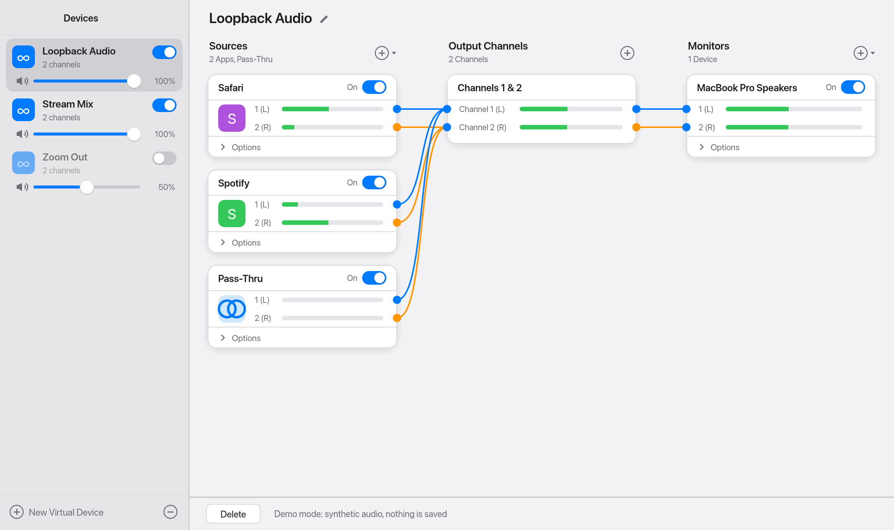

# SoundRouter

[](https://github.com/RONNCC/soundrouter/actions/workflows/ci.yml)  

A free, open-source alternative to Loopback and Soundflower for macOS, written in Rust. Create virtual audio devices, then route apps, microphones and monitors between them on a node graph.




## How routing works

```
 SOURCES                         ENGINE (in the app)                    OUTPUTS
 App taps (Safari, Spotify…) ─┐
 Input devices (microphones) ─┼─► private aggregate ─► IOProc ─► mixer ─┬─► virtual device INPUT ─► Zoom, OBS…
 Pass-Thru (apps playing INTO ┘   (one per device)        wires,        └─► monitors (speakers, headphones)
   the virtual device)                                    volume, mute

 While no engine runs, the driver loops what apps play into a virtual device straight to its input.
```

The driver (`SoundRouter.driver`, loaded by `coreaudiod`) only publishes the virtual devices. The routing runs in the SoundRouter app (its engine): it stops when you quit, and the devices then act as plain loopbacks. Details: [docs/ARCHITECTURE.md](docs/ARCHITECTURE.md).

## Features

- Virtual audio devices (up to 16) that any app can pick as an input or output, published by a Rust AudioServerPlugIn driver.
- Every new device is a Soundflower-style loopback out of the box: it starts with a Pass-Thru source wired 1→1, 2→2, so apps that play into it are heard on its input with no setup. Remove the wires or source to route differently.
- Node-graph routing GUI (egui), dark and light themes.
- Every source and monitor card has a × to remove it; a "Removed … · Undo" toast (6 s) brings back the card with its wires. Deleting a whole device offers the same Undo.
- Per-app capture through CoreAudio process taps, with "Mute in original output" per app source and "Choose App…" for apps that are not running.
- Device sources (microphones, interfaces), pass-thru sources, monitors (physical outputs), per-node volume and mute, level meters.
- Menu-bar background mode: closing the window keeps routing alive; Dock reopen; Start at Login (per-user LaunchAgent).
- First-run setup sheet: install or uninstall the driver in the app, permission steps, and a self-test.
- Single instance (lock file), config safety (corrupt config quarantined, newer-version config protected, fsync on save).
- Log file at `~/Library/Logs/SoundRouter/soundrouter.log`.
- `sr-cli`: `list`, `driver`, `loopback-test`, `run`, `meter`, `doctor`; `-v`/`-vv` for logging. `run` and `driver set` refuse (exit 1) while SoundRouter.app or another `sr-cli run` owns the audio engine (two engines keep resetting each other's driver list); `--force` overrides. Installed copies have it at `/Applications/SoundRouter.app/Contents/MacOS/sr-cli` (from source: `target/release/sr-cli`).

## Install

**From a release** (`.pkg` or `.dmg` on the [Releases page](https://github.com/RONNCC/soundrouter/releases); no release is published yet, see [docs/RELEASING.md](docs/RELEASING.md)): builds are ad-hoc signed unless the release says otherwise, so Gatekeeper blocks the first launch. On macOS 14: right-click the app, Open. On macOS 15: System Settings > Privacy & Security > Open Anyway. Then follow the setup sheet.

**From source** (macOS 14.2+, Command Line Tools, rustup with Rust 1.95; full Xcode not needed):

```sh
packaging/build-driver.sh          # target/SoundRouter.driver
packaging/bundle-app.sh            # target/SoundRouter.app (signed with the local dev identity if you made one, else ad-hoc)
packaging/driver-dev.sh install    # sudo: copies the driver to /Library/Audio/Plug-Ins/HAL, restarts coreaudiod
open target/SoundRouter.app        # or: cargo run -p soundrouter-app --release -- --demo   (no driver needed)
packaging/make-pkg.sh              # target/SoundRouter.pkg
packaging/make-dmg.sh              # target/SoundRouter.dmg
```

`bundle-app.sh` builds `ThirdPartyLicenses.html` with cargo-about: `cargo install --locked cargo-about --features cli`.

Distribution builds (Developer ID signing, notarization, the tag-triggered GitHub release workflow, and what to do without a Developer ID): [docs/RELEASING.md](docs/RELEASING.md).

**Signing and privacy grants.** Every ad-hoc build is a new app identity, so macOS resets Microphone and System Audio Recording grants on each rebuild. Run `packaging/make-dev-identity.sh` once: it creates a self-signed code-signing certificate, `SoundRouter Local Dev`, in your login keychain, and the build scripts then sign with it automatically (when `SIGN_ID` is unset). The app keeps one designated requirement (`identifier "com.ronncc.soundrouter" and certificate leaf = H"..."`), so grants survive rebuilds; grant them once after the first build signed this way. The certificate shows as "not trusted" in `security find-identity -v`; that is expected, and it cannot be notarized.

**Permissions.** Microphone (needed for any input, including the virtual device inside the engine's aggregate) and System Audio Recording (app taps). In the setup sheet (**Test Setup…**), each permission shows **Needs permission** until answered, with its own **Allow Microphone** / **Allow System Audio Recording** button; the footer button (**Allow All**, or the one name left, then **Continue**) asks for each one not answered yet (Microphone first, then System Audio Recording). If you denied one, its row shows **Open Settings**: turn SoundRouter on under System Settings › Privacy & Security › Screen & System Audio Recording › **System Audio Recording Only**. The sheet opens by itself only when something an existing source needs is missing, and not again in the same version once you finished or closed it.

**Uninstall:** the setup sheet's Uninstall…, or `packaging/uninstall.sh [--purge]` from a checkout. Without one: `/Library/Application Support/SoundRouter/uninstall.sh` (installed by the `.pkg`), `uninstall.sh` on the `.dmg`, or `SoundRouter.app/Contents/Resources/uninstall.sh`. It never deletes the app itself; drag that to the Trash.

## Use the Mac's microphone as a source

Example: Zoom hears your microphone plus Spotify.

1. Create a virtual device (or use the first-run "Loopback Audio"), select it, and click **+** above Sources.
2. Under **Audio Inputs** choose "MacBook Pro Microphone" (or any other input: a USB mic, an interface, BlackHole). Its channels are wired 1 -> 1 automatically. SoundRouter's own virtual devices are never listed.
3. Under **Applications** choose Spotify (apps that are playing audio are listed first; daemons and agents are hidden until you tick "Show background processes"; the search field filters both lists). Spotify is a stereo source, wired 1 -> 1, 2 -> 2.
4. Re-wire if needed: drag from a source's channel to an output channel. A mono microphone on channel 1 usually wants a second wire to channel 2 so both sides carry it. To remove a wire, click it, drag its right-hand end off into empty space, or click the input it ends on (which removes every wire into that input).
5. In Zoom pick the virtual device as the microphone. Do not add the microphone as a monitor unless you want to hear yourself.

macOS asks for Microphone access the first time (the setup sheet explains it); if it is denied the microphone's card says "Microphone denied" and the input stays silent until you allow it in System Settings > Privacy & Security > Microphone. An input source or monitor whose device is unplugged stays in the config and shows "Not connected" under the device's last known name; it starts carrying audio again when the device returns.

## Limits

Checked against the code (`crates/sr-core/src/config.rs`, `driver_proto.rs`, `sr-audio/src/engine.rs`):

- Device names: non-blank, at most 64 characters.
- Volume: at most +24 dB.
- App sources are always stereo (a process tap is a stereo mixdown).
- At most 16 virtual devices; device channels even, 2 to 64.
- An aggregate carries at most 64 input and 64 output channels (wider layouts fail the shape check).
- Process taps need macOS 14.2+ (the app's `LSMinimumSystemVersion`; every binary is built with `MACOSX_DEPLOYMENT_TARGET=14.2`).
- Apple silicon only: the app and driver are arm64 builds (no Intel or universal build); the `.pkg` refuses Intel Macs and macOS older than 14.2, and Finder refuses the app there.
- Engine latency: added latency = two IO buffers (+2.7 to +21.3 ms at 48 kHz; the footer shows it); buffer of 64, 128, 256 (default) or 512 frames (footer **Latency** menu, `sr-cli run --buffer N`); smaller costs more CPU and battery. See [ARCHITECTURE](docs/ARCHITECTURE.md#latency-setting).
- Virtual devices run at 44.1, 48 (default) or 96 kHz; a request for any other rate (88.2, 192 kHz) is refused. Input devices and monitors at other rates are resampled by the aggregate's drift compensation.
- Config `version` is 1; other versions are refused.

## Status

| Area | Verified | How |
|------|----------|-----|
| Core types, config validation, mixer, meters | Yes | unit, proptest, no-alloc tests (`cargo test --workspace`) |
| Driver logic and HAL entry points | Yes, outside coreaudiod | fake-host harness (`packaging/driver-dev.sh fakehost`), unit and proptests |
| GUI rendering and interaction | Yes | kittest + GPU snapshots (`--features snapshots`), `--demo` backend |
| Engine vs. an existing loopback device | Yes on a dev machine | BlackHole e2e (`#[ignore]`, needs BlackHole + permissions) |
| Driver running inside `coreaudiod` | Yes on a dev machine (macOS 14.7.1, Apple silicon, one 2 ch device) | `packaging/driver-dev.sh test` (sudo), `sr-cli loopback-test v1`; not run in CI |
| Hidden companion joining an aggregate | Yes, same machine | `packaging/engine-live-test.sh`: engine log shows main device `soundrouter:v1.engine`; the companion never shows in `system_profiler` |
| TCC and process taps, end to end with the installed driver | Yes for the `sr-cli` path with the terminal granted; the `.app`'s own prompts and grants **not verified** | `packaging/engine-live-test.sh`: `srtone` (into `soundrouter:v2`, silent) tap -> mixer -> V input, volume, mute, channel routing, stop reverts the input to the direct loop. Not covered: 44.1/96 kHz, more than one device, input-device sources and monitors through the installed driver, "Mute in original output" (the tap works with it set, that the original app goes silent on the speakers was not checked), long runs |
| Notarized release builds | **Not verified** | needs Developer ID credentials |

## Tests

```sh
cargo test --workspace                                    # unit, property and CLI tests
cargo test -p soundrouter-app --features snapshots        # GPU snapshots (UPDATE_SNAPSHOTS=1 to rewrite baselines)
cargo test -- --ignored                                   # hardware tests: driver installed, permissions granted
cargo test -p sr-audio --test blackhole -- --ignored      # BlackHole end-to-end
packaging/driver-dev.sh fakehost                          # driver in a fake host, no sudo
packaging/driver-dev.sh test                              # live checks against the installed driver (sudo)
packaging/engine-live-test.sh                             # live engine check: srtone tap -> installed driver (silent, no sudo)
```

The BlackHole test sets `SR_MAIN_UID_OVERRIDE` so the engine routes into an installed BlackHole device instead of SoundRouter's driver and never touches the driver. All tests are silent by design (tones only go into virtual devices). Details: [docs/TESTING.md](docs/TESTING.md).

Regenerate the screenshots: `cargo test -p soundrouter-app --features snapshots -- --ignored docs_screenshots`.

## Docs

[Architecture](docs/ARCHITECTURE.md), [Testing](docs/TESTING.md), [Troubleshooting](docs/TROUBLESHOOTING.md), [Releasing](docs/RELEASING.md), [Changelog](CHANGELOG.md), [original plan](docs/PLAN.md) (historical; superseded by the architecture doc).

## Provenance and license

SoundRouter is a clean-room implementation. It is not derived from BlackHole (GPL) or Loopback code. The icon artwork is original. Licensed MIT OR Apache-2.0.
