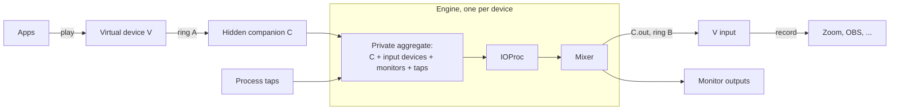

# Architecture

| Part | Role |
|------|------|
| `crates/sr-core` | Pure Rust: config, validation, mixer, meters, `Backend` trait, driver protocol. |
| `crates/sr-audio` | CoreAudio engine: taps, aggregates, IOProc, driver control client. |
| `crates/sr-cli` | Headless tool over the engine. |
| `driver` | AudioServerPlugIn cdylib (`SoundRouter.driver`). |
| `app` | eframe/egui GUI; talks to a `Backend` on a worker thread. |

## Companion-device design

For each virtual device V (what apps pick) the driver also publishes a hidden companion C (uid = V's uid + `COMPANION_SUFFIX`, `.engine`). Two rings connect them:

- V.out -> ring A -> C.in: what apps play into V.
- C.out -> ring B -> V.in: what apps record from V.

The engine uses C, never V, so it can read the apps' mix and write the routed mix without feeding back into itself. Apps that play directly into V are looped to V's input by the driver.

## Aggregate, IOProc, mixer

Per enabled virtual device the engine builds a private aggregate: the companion is the clock source; input devices and monitors join with drift compensation; each app source adds a process tap. One IOProc reads all input buffers (subdevices in list order, then taps), the mixer applies routing, gain and mute, and it writes C's output plus the monitor outputs. Shape mismatches are counted, not trusted (`layout_inputs`, `check_width`); layouts wider than 64 channels per direction fail the check.

## Control property `srcf`

The app sets a custom property `'srcf'` on the plug-in object (type `'plst'`): a CFArray of `{uid, name, channels}`, at most 16 entries. The driver diffs the list, adds or removes devices at runtime (no coreaudiod restart), requests configuration changes for channel changes, and persists the list through host storage so devices survive reboot. A second read-only property reports the protocol version. See `crates/sr-core/src/driver_proto.rs`, `sr-audio/src/driver.rs`.

## Threading rules

- IOProc (realtime): no allocation, locks, logging or ObjC. State arrives through atomics and a newest-plan mailbox; a test asserts the mixer does not allocate.
- `AudioDeviceStart` can block on the TCC prompt, so it runs on a starter thread; dropping a device joins that thread first, and `retire()` keeps callers from blocking.
- GUI thread never touches CoreAudio: a worker thread owns the backend and posts status and meters back.
- Driver entry points abort on panic and never block on the audio path.
