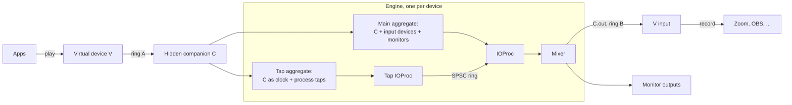

# Architecture

| Part | Role |
|------|------|
| `crates/sr-core` | Pure Rust: config, validation, mixer, meters, `Backend` trait, driver protocol. |
| `crates/sr-audio` | CoreAudio engine: taps, aggregates, IOProc, driver control client. |
| `crates/sr-cli` | Headless tool over the engine. |
| `driver` | AudioServerPlugIn cdylib (`SoundRouter.driver`). |
| `app` | eframe/egui GUI; talks to a `Backend` on a worker thread. |

## Companion-device design

For each virtual device V (what apps pick) the driver also publishes a hidden companion C (uid = V's uid + `COMPANION_SUFFIX`, `.engine`). Two rings connect them:

- V.out -> ring A -> C.in: what apps play into V.
- C.out -> ring B -> V.in: what apps record from V.

The engine uses C, never V, so it can read the apps' mix and write the routed mix without feeding back into itself. While no client runs I/O on C (engine not attached), V's input reads ring A instead, so apps that play into V hear themselves on V's input (Soundflower-style); once C runs, V's input is ring B. The switch is decided per I/O cycle from C's client count.

### Volume and mute on V

V (not C) publishes a volume and a mute control on each scope (4 control objects per slot, listed in `ControlList` and `OwnedObjects`; ids start at `CTRL_BASE`, after the device/stream ids). Volume is a `'vlme'` level control with a -64..0 dB range; scalar is linear in dB (0 -> -64 dB, 1 -> 0 dB, i.e. `convert` is exact and reversible) and the bottom of the range is exact silence. Defaults are 0 dB, unmuted; a slot reused for a new device resets them. Values are not persisted.

The gain is applied when reading, in `do_io`, from one precomputed `f32` per scope (the dB-to-gain conversion runs on the property-set path, so the real-time path does one atomic load and one multiply, no allocation). Samples are stored in the rings untouched:

| Read | Gain |
|---|---|
| C.in (engine, ring A) | V output level |
| V.in, C idle (direct loop, ring A) | V output level x V input level |
| V.in, engine running (ring B) | V input level |

Unity (0 dB, unmuted) skips the multiply, so the default path stays bit-exact; mute writes exact zeros. C has no controls and no gain.

**Fades.** A level change does not step: each read keeps the gain it ended on (`Slot::gain_last`, per reading side; reset when that side's last client stops, so a muted device starts silent) and moves toward the new one by at most `1 / (10 ms x rate)` per frame (`io::apply_gain`), so full scale to silence takes 10 ms at any buffer size and a reversal in mid-fade continues from where it was. Steady unity still skips the multiply and steady silence is still exact zeros.

**Taps follow V too.** The driver only sees what apps play *into V* (pass-thru). An app source is a process tap, which captures the app's audio before any device volume, so a tapped app ignores V's volume and mute (measured: with V's output volume at 0.5 or muted, a tapped `srtone` playing into V stayed at -14.0 / -20.0 dB on V's input). So the engine reads the same two output-scope controls (`engine/sysvol.rs`: V's `ControlList`, the volume control's scalar and the mute control's value, property listeners on both, no HAL call on the audio thread) and publishes `sr_core::driver_proto::volume_gain(scalar, muted)` through one atomic (`SysGain`, `MixerHandle::sys_gain`). The mixer multiplies it into the **app sources** of that device only (not device sources such as a mic, not pass-thru, which the driver already scaled), ramped linearly over the block like every other gain (one engine buffer, 5.3 ms at 256 frames), starting at V's current level when a plan first runs and carried across plan swaps. The mapping is shared with the driver (`VOLUME_MIN_DB`, tested equal). Input-scope controls are not followed by taps: they scale what apps record from V in the driver. The volume keys and Sound settings reach these controls because the HAL maps `VirtualMainVolume` and mute on a device with output-scope controls onto them (measured: setting `'vmvc'` 0.5 on V moves the control to 0.5 / -32 dB).

**Driver dependency.** Volume and mute on pass-thru and recordings work with the currently installed driver (it already has the controls and applies them per buffer: measured with `srctl vol|mute|vmv`, pass-thru -14.0 / -20.0 dB at unity, -46.0 / -52.0 at scalar 0.5 (-32 dB), -inf muted, unmute and `vmvc` 1.0 restore). That driver steps the gain at a buffer boundary: the recorded 1 ms envelope jumps 85 dB in one window on mute and 32 dB on a 0.5 step. The 10 ms fade needs the new driver. The taps' follow works with any driver that has the controls (the engine ramp is the only smoothing it needs: measured on the installed driver, mute and unmute fade over 6 ms, the 0.5 step over 6 ms with no jump above 16 dB per ms window). With a driver without controls V has none, `SysGain` stays unity.

### Overload counter

`WriteMix` calls that arrive late (scheduled before the device's current sample time) or larger than half the ring are counted per device in a relaxed atomic (no logging on the real-time path). A `ReadInput` whose read-ahead (next section) reached past the written frames is counted on the reading device too. The count is exposed read-only as custom property `'srov'` (CFNumber, 64-bit) on V and on C and resets when the slot is reused. Late writes are still written.

### Loop read-ahead (`'srla'`, off by default)

Through a ring a frame waits about two buffers: the writer stores it at output time ~now+B and the reader asks for it at input time ~now-B on the same sample timeline, so the frame has been sitting in the ring for up to two buffers when it is read. With read-ahead the reader reads `ahead` frames later on the timeline (`ring.read(ch, t + ahead, buf)`) and the app or engine gets each frame `ahead` frames sooner. Every ring traversal is shortened by `ahead`; the engine path (V.out -> C.in, C.out -> V.in) has two, the direct V loop one. Blackhole, BGM and eqMac read at `mInputTime` with no read-ahead.

How it stays safe (`ring::ReadAhead`, one per reading device; `do_io` calls `plan` once per `ReadInput`):

- **Measure.** `Ring::slack(t, frames)` = `end - (t + frames)`: written frames past the end of this read. Over the first 100 read cycles of a stream (more when writer and reader buffers differ: `writer_frames / gcd(writer_frames, frames)`, the cycles after which the two positions repeat; beats over 1024 cycles get no read-ahead) the reader reads at `t` (no read-ahead) and keeps the smallest slack. The writer's buffer size is the `frames` of its last `write`, stored in the ring.
- **Freeze.** `ahead = clamp(min_slack - guard, 0, 4 * max(frames, writer_frames))` with `guard = max(16, frames / 8)`, then it never changes: a moving `ahead` replays or drops audio.
- **Shortfall.** A read whose `t + ahead + frames` is past `end` gets silence for the frames beyond it (the ring only ever returns frames below its release-stored `end`) and is counted in `'srov'`. A second shortfall without 65536 clean cycles in between halves `ahead` (the one back-off step); a lone one, such as a writer thread stalled once, changes nothing.
- **Restart.** Calibration starts over (`ahead` back to 0) when I/O stops on either side of the slot, when the reader's or writer's buffer size changes, when `t` jumps (not 0..4 cycles forward), when the ring is empty or was reset (format changes and slot reuse reset it), and when the switch is flipped.
- **Order of calls.** The ring is only read below `end`, so reading ahead cannot return data that was never written. What the writer's phase can change is slack: when V's and C's threads wake together, the reader sometimes runs before and sometimes after the writer's cycle lands (slack differs by one writer buffer). Calibration normally sees the lower of the two (reader first) within 100 cycles and sizes `ahead` for it. If the order flips only rarely, calibration can miss the lower slack: then the first flip is a shortfall (a silent tail of up to `ahead - slack` frames, counted), the second halves `ahead` below the lower slack and the stream is clean afterwards (never more than two in the model, `ring.rs` tests).
- **Real-time rules.** `plan` and `do_io` use relaxed atomics only: no allocation, locks or logging.

The switch is the custom property `'srla'` on the plug-in object (`'plst'` CFNumber, settable, nonzero = on; `READ_AHEAD_DEFAULT` = off, not persisted, so whoever wants it writes it after every driver start). Flipping it restarts every calibration. It is off because it has only run against the HAL model in the unit tests and `packaging/fakehost.c`, not in a real coreaudiod: turn the default on after a live run shows `'srov'` staying put.

Frames saved per traversal with equal reader and writer buffers `B`: `B - guard` (fakehost, impulse through the HAL model: V loop 2B -> B + guard, engine loop 4B -> 2B + 2 * guard, the same with the engine's read racing V's write):

| B (frames) | per traversal | engine loop (2 traversals) | engine loop at 48 kHz, before -> after |
|---|---|---|---|
| 64 | 48 (1.0 ms) | 96 (2.0 ms) | 5.33 -> 3.33 ms |
| 128 | 112 (2.3 ms) | 224 (4.7 ms) | 10.67 -> 6.00 ms |
| 256 | 224 (4.7 ms) | 448 (9.3 ms) | 21.33 -> 12.00 ms |
| 512 | 448 (9.3 ms) | 896 (18.7 ms) | 42.67 -> 24.00 ms |
| 1024 | 896 (18.7 ms) | 1792 (37.3 ms) | 85.33 -> 48.00 ms |

Different reader and writer buffers (V's size is the client app's, the engine's the Audio delay setting) save whatever the measured slack leaves; the model above assumes equal ones. Read-ahead does not touch the aggregate's own offsets (process-tap safety offset, drift compensation). The driver must be reinstalled to get any of this.

### Clock and zero timestamps

V and C of a slot share one timeline: the same `anchor` (set when the first client on either side starts) and the same `seed`, and the same `ClockDomain`. Each device then derives its sample time from its *own* nominal rate (`GetZeroTimeStamp` must stay consistent with the rate the HAL configured on that device, so a 96 kHz V cannot report 48 kHz-period timestamps). Consequence: V and C report identical zero timestamps exactly while their rates agree. They differ only while a rate change has landed on one side; the driver asks both devices to follow, and until both do the pair is silent (`Slot::in_sync`). The HAL may run the per-device `PerformDeviceConfigurationChange` calls late and in any order, so a Perform applies the last requested rate (`rate_want`), never the rate carried in its request, and every new rate asks both devices again (`Slot::want`, `Slot::perform`; channel counts work the same way). Tests: `v_and_c_report_identical_zero_timestamps_at_one_rate` (identical at one rate), `zero_timestamp_uses_the_devices_own_rate` (diverge at different rates), `format_converges_to_the_last_set` (any Perform order, rates and channel counts), and the fakehost zero-timestamp and rapid-rate checks.

### Default-device flags

- V: `CanBeDefaultDevice` = 1 (both scopes; users and apps choose it as input/output), `CanBeDefaultSystemDevice` = 0. Alerts and sound effects should not be swallowed by a loopback nobody may be listening to; choosing V as the system device in Sound settings is left out on purpose.
- C: both 0, and C is hidden: it is the engine's private endpoint and must never become a default or appear in pickers.

## Aggregate, IOProc, mixer

Per enabled virtual device the engine builds a private aggregate: the companion is the clock source; input devices and monitors join with drift compensation. One IOProc reads all input buffers (subdevices in list order), the mixer applies routing, gain and mute, and it writes C's output plus the monitor outputs. Shape mismatches are counted, not trusted (`layout_inputs`, `check_width`); layouts wider than 64 channels per direction fail the check.

### Tap aggregate (split)

Each app source adds a process tap, and any process tap in an aggregate raises that aggregate's safety offset to 1024 frames in each direction for every path in it (see the latency model). So the taps live in a second private aggregate of the same device (`engine/tapagg.rs`): only the companion (main, clock, drift off: the same clock as the main aggregate) and the taps. Its IOProc copies the tap buffers (the last N input buffers of its list, frame-major, all taps' channels back to back) into a lock-free SPSC ring (`tapring.rs`, `rtrb`, preallocated, 8 cushions deep, at least `MAX_FRAMES` frames) and writes nothing to C's output. The main IOProc pops from that ring into the mixer's tap input slots, behind its own input channels: it asks the mixer's current plan how many inputs it expects (`Mixer::in_len`) and supplies exactly that many, silence for the tap slots whenever the ring in hand has another channel count. So the plan and the ring can swap in either order, and mic, pass-thru and monitor paths never see a mismatch or a gap while taps come and go.

- **Cushion and counters.** The tap IOProc pushes whole blocks (one cycle's frames) and the main IOProc pulls whole blocks, so a margin below one block is no margin: one late tap cycle leaves the ring short and the whole block is replaced by silence. The kept frames are therefore the cushion rounded up to whole tap blocks (`tapring::keep_frames`; the default cushion, `default_cushion`, is one IO buffer = one block; `SR_TAP_CUSHION=<frames>` overrides it, and `0` alone keeps nothing, for measuring). The first read waits until a block plus that margin is buffered, drops the surplus oldest frames above it (a stream start, not a counted trim), then free-runs: both IOProcs run on the companion's clock, so there is no drift to correct. An empty ring gives one block of silence, counts an underrun and waits for the cushion again; more than three blocks beyond the cushion drops the oldest frames down to it (a trim); a full ring makes the producer drop the block (`dropped`). `Engine::tap_counters` / `sr-cli run` show them next to `glitches`.
- **Rebuild.** Adding or removing a tap rebuilds the tap aggregate only (`rebuild_tap_agg`): the new one is built and started, its ring is published to the main IOProc through a one-slot mailbox (the mixer plan's pattern, retired rings come back on a queue), the layout is republished, then the old aggregate is stopped and destroyed together with the taps that left. The tapped apps are silent from that swap until the new aggregate runs (tens of ms); everything else keeps running. A process that only gains helper processes just updates the tap description in place.
- **Start and permission.** `AudioDeviceStart` of the tap aggregate blocks while the System Audio Recording prompt is open; it runs on its own starter thread. The main aggregate starts at once, so a mic or pass-thru route is not held by the prompt; the device reports `WaitingForPermission` only while its tap aggregate is the one waiting. A failed tap start rebuilds the whole vdev (bounded like any failed start).
- **Teardown order.** tap IOProc stopped, main IOProc stopped, tap aggregate destroyed, main aggregate destroyed, then the taps. A tap aggregate still starting is torn down on a reaper thread.
- **Rates.** The tap aggregate follows the companion's rate; a rate or layout change of the companion or any sub-device rebuilds the whole vdev as before.
- **Switch.** `SR_TAP_SPLIT=0` builds the old single aggregate with the taps inside (A/B); `SR_TAP_SPLIT=1` forces the split. The split is part of the reuse key, so changing it rebuilds the vdev.

### Audio delay setting

The engine path adds two of the aggregate's IO buffers (input and output side; added latency = two buffers) on top of the driver's own loop. `Config::buffer_frames` (one of 64, 128, 256 or 512; default 256, older configs without the field load as 256) is set on each aggregate with `kAudioDevicePropertyBufferFrameSize` right before its IOProc is created, after checking `kAudioDevicePropertyBufferFrameSizeRange`; a size outside the range or a HAL error keeps the aggregate's default and is logged at info. Changing it rebuilds the aggregates (a short dropout). The app sets it from the footer's **Delay** button (an **Audio delay** menu of Lowest, Low, Balanced (recommended) and Safest = 64, 128, 256 and 512 frames, each showing the added delay, two buffers: 2.7, 5.3, 10.7 or 21.3 ms at 48 kHz), `sr-cli run --buffer N` overrides the config. Smaller buffers wake the IOProc more often: more CPU and battery, and less headroom before a busy system makes the HAL skip a cycle (counted by `Engine::glitches`).

Measured on an M3 Max (macOS 14.7.1, 48 kHz, installed driver, Pass-Thru route, `srctl loop soundrouter:v1 128` = V.out -> companion -> engine -> V.in): the driver alone loops in 5.33 ms; with the engine at 512 / 256 / 128 / 64 frames the loop takes 26.67 / 16.00 / 10.67 / 8.00 ms, i.e. the engine adds two of its buffers (input and output side). With 8 `yes` CPU burners running, `Engine::glitches` stayed at 0 at every size.

### Latency model (verified)

What the engine adds to a route is the distance its IOProc reports: `output_time.mSampleTime - input_time.mSampleTime` of the same cycle, stored per cycle in `Shared::delay` (one relaxed store) and exposed as `Engine::delay(id)` (the longer of the main and app paths), `Engine::main_delay(id)` and `EngineStatus::delays` (main path only; the app path is `EngineStatus::tap_delays`) (frames plus the main device's rate, `Delay::ms`). `sr-cli run` prints it ("delay 5.3 ms") and the app can show it from the status; nothing is estimated from the buffer setting. On an M3 Max at 48 kHz with the installed driver, a route from V through the engine and back to V satisfies `loop = B_V + added`, where `B_V` is the buffer the client app asked V for and `added` is the reported distance (Pass-Thru route, engine at 128 / 512 / 64 frames: loop 8.00 / 32.01 / 4.00 ms with `B_V` = 128 / 512 / 64 frames, reported 5.3 / 21.3 / 2.7 ms).

- **Buffers.** Without process taps `added` is two engine buffers (input and output side), as above. A buffer size requested from the engine process for V or C changes neither a client's IO cycle (the HAL keeps one per client: a client that never asks gets 512) nor the loop, so the engine only sets its aggregate's size and `B_V` stays the client app's choice.
- **Process taps.** Any process tap in an aggregate adds a fixed 1024-frame safety offset to the input side and another to the output side of that aggregate, whatever the buffer size or rate, and it applies to every path through it (mic, pass-thru, monitors too, not only the tapped app). Measured with one app source in the single aggregate (`SR_TAP_SPLIT=0`): the reported distance is 48.0 ms at 128 frames, 45.3 ms at 64 and 53.3 ms at 256, against 5.3 / 2.7 / 10.7 ms without the tap (+42.7 ms at 48 kHz).
- **Split taps.** With the taps in their own aggregate (see "Tap aggregate (split)") the main aggregate keeps the no-tap numbers while apps are tapped: pass-thru, mic and monitor paths report 5.3 / 2.7 / 10.7 ms at 128 / 64 / 256 frames, and `srctl loop soundrouter:v1 <B>` with a tapped player running takes 10.66 ms at 128 (53.34 ms unsplit) and 5.33 ms at 64 (48.00 unsplit). The tapped apps still carry one safety offset (on the tap aggregate's input side only) plus the ring: `EngineStatus::tap_delays` / `Engine::tap_delay(id)` report it as how stale the audio is when the tap IOProc gets it (`now - input time`), plus the frames left in the ring after the last read, plus how far the main output lies ahead of the clock (`Shared::lead`): 29.3 / 25.4 / 37.3 ms at 128 / 64 / 256 frames, i.e. 1024 + 3 buffers (1408 frames at 128). It leaves out the wait for the main IOProc's phase (up to one buffer) and the driver's own hops. End to end, an impulse played by a tapped process into `soundrouter:v2` and detected on `soundrouter:v1`'s input (host timestamps of both buffers) takes 50.7 / 47.6 / 59.1 ms split against 68.7 / 67.3 / 71.3 ms unsplit at 128 / 64 / 256 frames: the tapped route gains 17.9 / 19.8 / 12.2 ms, every other route 42.7 ms. `Engine::delay(id)` and `EngineStatus::delays` report the longer of the two paths (what the slowest source costs), `tap_delays` only the app one, so a UI can say "Mic and Pass-Thru: X ms, apps: Y ms".
- **Tap path experiments (E1).** Measured on an M3 Max, macOS 14.7.1, 48 kHz, installed driver (older than main), engine buffer 256 unless stated. Method: a scratch tool (not in the repo) plays a 0.5 impulse every 4801 frames into `soundrouter:v2` (it is the tapped process, `path:` source into `v1`) and detects it on `soundrouter:v1`'s input, with both clients at 128 frames; "e2e" is the wall-clock time from the write to the detection callback (it includes the clients' two 128-frame buffers, so only differences count), "apps" is `EngineStatus::tap_delays`. Within a run the e2e value does not move (all clocks share the driver's timeline); between restarts it varies by up to 3 ms because the two IOProc threads start in a random phase, so e2e needs several restarts and the engine's own number is the reliable one.

| Experiment | apps (engine) | e2e | Verdict |
|---|---|---|---|
| baseline | 37.3 ms | 63.9-68.1 ms (7 starts) | |
| (a) sub-tap `latency-in` -1024 / -512 / +512 | 37.3 / 37.4 / 37.3 | 64.2 / 66.9 / 65.5 | no effect |
| (a) `latency-out` -1024; both -1024 | 37.3 / 37.3 | 65.2 / 68.3 | no effect (never better than baseline) |
| (a) `'xltc'` on the sub-tap | - | - | the sub-tap object answers every property with `'!obj'` (class too), so it cannot be set |
| (b) tap `drift` on vs off, 5 min each | 37.3 vs 37.4 | 67.90 vs 67.83 ms, 2990 / 2992 impulses | identical; 0 underruns, trims, drops; CPU 2.3 % vs 2.6 %; kept on (below) |
| (f) cushion 256 frames (one block, default) / 0 at 256 frames | 37.3 / 32.0 | 59.5-60.1 / 53.3-57.7 ms | kept: one block (below); 0 has no margin |

  - (a) The latency keys are accepted (the composition reads back `"latency-in" = -1024`) but move neither the timestamps the IOProc sees nor the real delay: they shift how the HAL aligns the tap against other sub-devices, and the tap aggregate has only the companion. Nobody lowers the 1024-frame safety offset; this does not either.
  - (b) The test player plays into a virtual device on the driver's own clock, so there is no clock difference to compensate and off is trivially clean. A real app plays to hardware whose clock differs from the companion's (`kAudioDevicePropertyClockDomain`: built-in speakers and microphone 1835100526, `soundrouter:v1` 1397882886, `v2` 1397882890, BlackHole and the Teams driver 0), which is exactly what the tap's drift compensation is for, and listening to hardware without audible output was out of bounds, so the claim "off is safe" could not be shown. Drift compensation costs nothing measurable (no delay change, CPU within noise), so it stays on.
  - (c) HAL drift compensation on sub-devices sharing the main's clock domain: the main is always the companion, whose domain no hardware device shares (the table above), so the rule would never fire. Not built. (Built-in microphone and speaker do share one domain, but they only ever join as sub-devices of the companion.)
  - (e) A Bluetooth device as the aggregate's clock: `main_candidates` only offers the companion or the visible virtual device (`SR_MAIN_UID_OVERRIDE` aside), so a hardware device is never the main. Nothing to change.
  - (f) Cushion, in frames kept in the ring after each read (apps path, engine-reported, plus end to end with the impulse method above; each setting 2 restarts calm and 2 under 8 CPU burners at 64 / 128 / 256 frames: 0 underruns, 0 trims, 0 drops, 0 glitches). A first attempt set the cushion to a quarter of the buffer (32..128 frames) and reported 24.7 / 27.3 / 33.3 ms at 64 / 128 / 256 frames; that was not a gain but the margin disappearing: the tap IOProc delivers whole blocks, so a sub-block cushion leaves a late tap cycle nothing to read (the unit test `a_margin_below_one_block_loses_the_block_on_a_late_push` shows the lost block), and the clean runs were only the lucky phase of the two IOProc threads. The default is one block again. Measured at 64 / 128 / 256 frames, default cushion = one block: engine-reported apps path 25.3 / 29.3 / 37.3 ms (calm and under burners), end to end 46.7-48.0 / 50.5-52.2 / 59.5-60.1 ms calm and 46.3-46.4 / 51.0-52.4 / 62.8-63.1 ms under 8 burners (the spread between restarts is the threads' random start phase). `SR_TAP_CUSHION=0` (no margin at all) reports 32.0 ms at 256 frames and 53.3-57.7 ms end to end, and ran clean here, but one late cycle then loses a whole block.
  - **No adaptive resampler.** It was only to be built if drift were still needed and the ring dominated the apps' path. Neither holds: the ring (cushion) is one buffer, 256 of 1600 frames at the default size, the 1024-frame safety offset is 57 % of the path and cannot be lowered, and the free-running ring held its level for 5 minutes (0 trims, 0 underruns, level unchanged). A DLL-driven resampler would add its own fixed delay and CPU for no delay gain.
- **Drift compensation.** Input devices and monitors join with drift compensation, which has a fixed resampler delay per hop and direction. The sub-device dict sets `kAudioSubDeviceDriftCompensationQualityKey` to `kAudioAggregateDriftCompensationLowQuality` (0x20): measured one way through BlackHole 16ch as a monitor and as an input device, drift off / default quality / Low quality add 0 / 0.98 / 0.17 ms (about 47 / 8 frames), so Low saves 0.8 ms per direction and costs 0.17 ms against no compensation. The reported distance does not include this resampler delay (it is not in the timestamps): add about 0.2 ms per drift-compensated device on the path.
- **`drift` must be a CFNumber.** The HAL stores a CFBoolean `drift` value as 0 (read back from `kAudioAggregateDevicePropertyComposition`), so before this the aggregates never compensated drift at all. The engine now passes `NSNumber::new_i32`. The tap dict's `kAudioSubTapDriftCompensationKey` passes a CFBoolean, which the HAL does keep for sub-taps (the aggregate composition reads back `drift = 1` for the tap; `0` when a CFNumber 0 is passed).
- **Low Power Mode and App Nap.** `EngineStatus::low_power_mode` reports `NSProcessInfo.isLowPowerModeEnabled`, because lower clocks make the small buffers glitch sooner. While any virtual device's IOProc exists the engine holds one `NSProcessInfo` activity (`NSActivityUserInitiatedAllowingIdleSystemSleep | NSActivityLatencyCritical`, reason "SoundRouter routing", `activity.rs`) so App Nap cannot throttle the process; it begins with the first device and ends with the last one dropped.

### Mute in original output with the split aggregate (measured)

"Mute in original output" (`Source::mute_original`, the per-app "Mute when capturing") sets `CATapMuteBehavior` on that app's tap, and the tap lives in the tap aggregate now. Measured with the split aggregate (default; macOS 14.7.1, installed driver, `srtone` playing into BlackHole 16ch ch 8-9, `sr-cli meter BlackHole16ch_UID` as the observer of the app's own output, `sr-cli meter v1` for the routed signal): no engine -14.0 / -20.0 on BlackHole; engine running with the option off: BlackHole still -14.0 / -20.0, routed to V; option on: BlackHole -inf (the app is silent in its original output) while V still carries the tone; engine stopped: BlackHole back at -14.0 / -20.0 within 2 s. (V reads -32.0 / -38.1 there, not -14.0 / -20.0: the tap's stereo mix-down of a 16-channel output divides each channel by 8, -18.1 dB, unrelated to volume.)

## Robustness

### Crashed engine: no orphan sweep needed (measured)

FineTune and cpal sweep aggregates left behind by a crashed process, because a tap with mute-when-tapped keeps silencing its app until it is destroyed. Measured here (macOS 14.7.1, `sr-cli run` with a tapped `srtone` playing into BlackHole 16ch ch 8-9, "Mute in original output" on, `sr-cli meter BlackHole16ch_UID` as the observer): audible -14.0 / -20.0 dB, while the tap runs -inf, 3 s after `kill -9` of the engine back to -14.0 / -20.0 and still there 10 s later. coreaudiod's log shows it unregistering the dead client's IO context and releasing its power assertions at that moment. The same uids (`soundrouter.agg.v1.0`, ...) were created again by a second run right after a `kill -9` of the first, so no aggregate survived either. Our aggregates and taps are all private (`IsPrivate`, `setPrivate(true)`), which also means no other process can enumerate them (`kAudioHardwarePropertyDevices` and `kAudioHardwarePropertyTapList` list none from `sr-cli doctor` while an engine runs), so a sweep would have nothing to find and nothing to destroy: it is not built. Revisit only if a tap or aggregate is ever created non-private.

### Device events and engine health

Every event funnels into the one `sr-audio-events` worker thread (the HAL calls the listener blocks on its own threads; they only send on a channel or do one relaxed atomic add, never touch the IOProc). Per device of a vdev (main and sub-devices) the engine listens to `NominalSampleRate`, `StreamConfiguration`, `DeviceIsAlive` and `ProcessorOverload`; per aggregate (main and tap) to `ProcessorOverload` and `BufferFrameSize`; on the system object to the device and process lists, `kAudioHardwarePropertyServiceRestarted` and `DefaultOutputDevice`.

| Event | Reaction |
|---|---|
| `ProcessorOverload` | counted in the vdev's `xruns` (atomic, summed over its devices and both aggregates); `EngineStatus::xruns` |
| `DeviceIsAlive` | a device that is gone or reads not alive rebuilds the vdevs built on it (`dead_targets`); a flap back to alive changes nothing |
| `BufferFrameSize` of an aggregate | set back to the requested size when something else changed it, at most 3 times per vdev (`should_reset_buffer`) |
| `ServiceRestarted` | every object id is stale after a coreaudiod restart: handled as a wake, all vdevs are torn down and rebuilt after the 1 s settle |
| `DefaultOutputDevice` | re-reads the device list, which only acts when the set of devices really changed; the status fields below read the HAL live, so nothing is cached to refresh |

`EngineStatus` gained four additive fields (all `Default`): `xruns: Vec<(vdev id, u64)>`, `tap_silent: Vec<vdev id>`, `hogged: Vec<HogInfo>` and `bluetooth_hfp: Vec<device name>`. `sr-cli run` prints them as a `health:` line every 2 s; `sr-cli doctor` (which has no engine) lists hogged devices and Bluetooth devices at a headset rate.

- **`tap_silent`.** A denied System Audio Recording permission does not fail the tap: it delivers all-zero buffers with no error. The `sr-audio-health` thread looks at each vdev every 500 ms: the tapped source counts as active while its tap path runs and one of its processes reports `kAudioProcessPropertyIsRunningOutput`; signal is the mixer's input meter peak of the source's slots since the previous look (`Meters::drain_source_peak`, a second set of peak cells drained only by this thread, so the window's own `take` never steals it). Active with a peak of exactly 0.0 for 3 s (`SilenceWatch`, a state machine driven by an injected monotonic time, so the tests need no timers) flags the vdev; any signal, or the app stopping its output, clears it at once. A source that is not playing is never flagged. The watch only runs while `tcc::audio_capture_status()` is not `Granted` (`health::watch_taps`): once the permission is granted, digital silence from a running app is legitimate and is never reported. `Unknown` (not asked yet, or the private preflight unreadable, which is what an ad-hoc signed build may report even when the permission is denied) is watched like `Denied`, so the flag can still be set for an app that plays silence there. In a split vdev the observation starts only when the main aggregate and the tap aggregate both run (`taps_running`), so the start-up silence of either is never counted.
- **`hogged`.** `kAudioDevicePropertyHogMode` of every device the enabled virtual devices use (device sources and enabled monitors): the holder's pid and executable name (`proc_name`). Another process's exclusive mode makes routes through the device carry nothing, which is otherwise a silent failure.
- **`bluetooth_hfp`.** A Bluetooth device (`'blue'` / `'blea'` transport) with an input stream open in our aggregate and a nominal rate of 24 kHz or less, or fewer output channels than when the aggregate was built, is probably in the headset profile (`looks_hfp`). A device used by several virtual devices is judged on all of them (input open in any, the widest output any was built with), not on whichever comes first. Not verified live: no Bluetooth audio device was available.
- **Unread input streams are switched off.** A monitor-only device (a Bluetooth headset used as output) joins the aggregate with all its streams, so the aggregate opens its microphone and macOS drops the headset from A2DP to HFP (16 kHz mono). After the IOProc is created the engine sets `kAudioDevicePropertyIOProcStreamUsage` (input scope) so that only the main device and the Device sources are on (`restrict_inputs`, whose flags also cover the tap input streams an unsplit (`SR_TAP_SPLIT=0`) aggregate carries after the sub-devices' streams, always on, and which is sent again after `sync_taps` changes that tap list; `AggSpec::readers` is part of the reuse key, so adding a Device source for a monitor's device rebuilds). The buffers keep their shape: with BlackHole 16ch as a monitor the route stayed at -14.0 / -20.0 dB, shape mismatches 0, glitches 0, and the property call returned success. That the Bluetooth profile stays A2DP is not verified (no such device here).

## Presets

A preset (`sr_core::preset`) is `{name, buffer_frames, devices}`: the config's devices with everything the GUI edits, and the Audio delay setting. `presets.json` (`{version, presets}`, `sr_core::preset_store`) sits next to `config.json`; writes are atomic (`sr_core::fsio::write_atomic`), unknown fields are ignored on load and not kept on save, a corrupt, oversized or non-UTF-8 file is moved to `presets.json.bad` and reported, and a file with a newer `version` is ignored and never overwritten. A preset that no longer validates is kept; applying it reports why.

`preset::plan(current, preset)` is the one place presets meet the config. Devices are matched by id. A device that exists keeps its place, name and on/off state and takes the preset's routing, volume, mute, monitors and channel count (a preset that has it on turns it on); one that does not exist is appended; devices the preset does not mention are untouched; the delay setting becomes the preset's. The result must pass `Config::validate`. `Plan::changes` lists what the driver would see (a device added, turned on, or resized); the driver's list is only ever derived from the config, so the app asks (`Plan::confirm`) before committing a plan with changes, from the menu, the menu-bar submenu and links alike, and applies plans without changes at once. An applied preset is one `Undo` (the config before it), the same toast as a removal.

Links: the bundle declares the `soundrouter` scheme (`CFBundleURLTypes`). A launch by link delivers its "get URL" Apple event before the window creator runs, so `deeplink::install` registers the handler from `main` before `eframe::run_native`; links wait in a small bounded queue that `App::logic` drains (it also runs while the window is hidden). `soundrouter://preset/<percent-encoded name>` is the only action (`preset::parse_url`). `sr-cli preset apply` asks a running app through `open soundrouter://preset/...` (the app owns the live config and the undo); without the app it edits `config.json` itself.

A physical input or monitor that disappears keeps its config entry (name, wires, gain, mute); the engine drops it from the aggregate and the mixer plan (`MixPlan::compile` skips wires whose source is absent from the layout) and rebuilds on the hot-plug event, so it routes as before when it returns.

## Control property `srcf`

The app sets a custom property `'srcf'` on the plug-in object (type `'plst'`): a CFArray of `{uid, name, channels}`, at most 16 entries; every uid must start with `soundrouter:`. Any local process can set the property (the driver does not check the caller), so it validates everything and keeps the list out of other devices' uid namespace; a hostile process can still remove or rename the user's virtual devices, but cannot read audio (the Microphone permission gates their input). The driver diffs the list, adds or removes devices at runtime (no coreaudiod restart), requests configuration changes for channel changes (both devices; each Perform sets its own device to the count the list wants now, `ch_want`, never the count in its request, so late or reordered Performs such as 2 → 8 → 16 → 8 still end at 8 on V and C; until both land the pair is silent), and persists the list through host storage so devices survive reboot. A second read-only property reports the protocol version. See `crates/sr-core/src/driver_proto.rs`, `sr-audio/src/driver.rs`.

## Threading rules

- IOProc (realtime): no allocation, locks, logging or ObjC. State arrives through atomics and a newest-plan mailbox; a test asserts the mixer does not allocate.
- `AudioDeviceStart` can block on the TCC prompt, so it runs on a starter thread; dropping a device joins that thread first, and `retire()` keeps callers from blocking.
- GUI thread never touches CoreAudio: a worker thread owns the backend and posts status and meters back.
- Driver entry points abort on panic and never block on the audio path.
