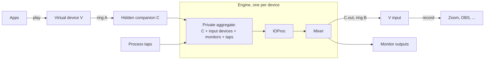

# Architecture

| Part | Role |
|------|------|
| `crates/sr-core` | Pure Rust: config, validation, mixer, meters, `Backend` trait, driver protocol. |
| `crates/sr-audio` | CoreAudio engine: taps, aggregates, IOProc, driver control client. |
| `crates/sr-cli` | Headless tool over the engine. |
| `driver` | AudioServerPlugIn cdylib (`SoundRouter.driver`). |
| `app` | eframe/egui GUI; talks to a `Backend` on a worker thread. |

## Companion-device design

For each virtual device V (what apps pick) the driver also publishes a hidden companion C (uid = V's uid + `COMPANION_SUFFIX`, `.engine`). Two rings connect them:

- V.out -> ring A -> C.in: what apps play into V.
- C.out -> ring B -> V.in: what apps record from V.

The engine uses C, never V, so it can read the apps' mix and write the routed mix without feeding back into itself. While no client runs I/O on C (engine not attached), V's input reads ring A instead, so apps that play into V hear themselves on V's input (Soundflower-style); once C runs, V's input is ring B. The switch is decided per I/O cycle from C's client count.

### Volume and mute on V

V (not C) publishes a volume and a mute control on each scope (4 control objects per slot, listed in `ControlList` and `OwnedObjects`; ids start at `CTRL_BASE`, after the device/stream ids). Volume is a `'vlme'` level control with a -64..0 dB range; scalar is linear in dB (0 -> -64 dB, 1 -> 0 dB, i.e. `convert` is exact and reversible) and the bottom of the range is exact silence. Defaults are 0 dB, unmuted; a slot reused for a new device resets them. Values are not persisted.

The gain is applied when reading, in `do_io`, from one precomputed `f32` per scope (the dB-to-gain conversion runs on the property-set path, so the real-time path does one atomic load and one multiply, no allocation). Samples are stored in the rings untouched:

| Read | Gain |
|---|---|
| C.in (engine, ring A) | V output level |
| V.in, C idle (direct loop, ring A) | V output level x V input level |
| V.in, engine running (ring B) | V input level |

Unity (0 dB, unmuted) skips the multiply, so the default path stays bit-exact; mute writes exact zeros. C has no controls and no gain.

### Overload counter

`WriteMix` calls that arrive late (scheduled before the device's current sample time) or larger than half the ring are counted per device in a relaxed atomic (no logging on the real-time path). The count is exposed read-only as custom property `'srov'` (CFNumber, 64-bit) on V and on C and resets when the slot is reused. Late writes are still written.

### Clock and zero timestamps

V and C of a slot share one timeline: the same `anchor` (set when the first client on either side starts) and the same `seed`, and the same `ClockDomain`. Each device then derives its sample time from its *own* nominal rate (`GetZeroTimeStamp` must stay consistent with the rate the HAL configured on that device, so a 96 kHz V cannot report 48 kHz-period timestamps). Consequence: V and C report identical zero timestamps exactly while their rates agree. They differ only while a rate change has landed on one side; the driver asks both devices to follow, and until both do the pair is silent (`Slot::in_sync`). The HAL may run the per-device `PerformDeviceConfigurationChange` calls late and in any order, so a Perform applies the last requested rate (`rate_want`), never the rate carried in its request, and every new rate asks both devices again (`Slot::want`, `Slot::perform`; channel counts work the same way). Tests: `v_and_c_report_identical_zero_timestamps_at_one_rate` (identical at one rate), `zero_timestamp_uses_the_devices_own_rate` (diverge at different rates), `format_converges_to_the_last_set` (any Perform order, rates and channel counts), and the fakehost zero-timestamp and rapid-rate checks.

### Default-device flags

- V: `CanBeDefaultDevice` = 1 (both scopes; users and apps choose it as input/output), `CanBeDefaultSystemDevice` = 0. Alerts and sound effects should not be swallowed by a loopback nobody may be listening to; choosing V as the system device in Sound settings is left out on purpose.
- C: both 0, and C is hidden: it is the engine's private endpoint and must never become a default or appear in pickers.

## Aggregate, IOProc, mixer

Per enabled virtual device the engine builds a private aggregate: the companion is the clock source; input devices and monitors join with drift compensation; each app source adds a process tap. One IOProc reads all input buffers (subdevices in list order, then taps), the mixer applies routing, gain and mute, and it writes C's output plus the monitor outputs. Shape mismatches are counted, not trusted (`layout_inputs`, `check_width`); layouts wider than 64 channels per direction fail the check.

### Audio delay setting

The engine path adds two of the aggregate's IO buffers (input and output side; added latency = two buffers) on top of the driver's own loop. `Config::buffer_frames` (one of 64, 128, 256 or 512; default 256, older configs without the field load as 256) is set on each aggregate with `kAudioDevicePropertyBufferFrameSize` right before its IOProc is created, after checking `kAudioDevicePropertyBufferFrameSizeRange`; a size outside the range or a HAL error keeps the aggregate's default and is logged at info. Changing it rebuilds the aggregates (a short dropout). The app sets it from the footer's **Delay** button (an **Audio delay** menu of Lowest, Low, Balanced (recommended) and Safest = 64, 128, 256 and 512 frames, each showing the added delay, two buffers: 2.7, 5.3, 10.7 or 21.3 ms at 48 kHz), `sr-cli run --buffer N` overrides the config. Smaller buffers wake the IOProc more often: more CPU and battery, and less headroom before a busy system makes the HAL skip a cycle (counted by `Engine::glitches`).

Measured on an M3 Max (macOS 14.7.1, 48 kHz, installed driver, Pass-Thru route, `srctl loop soundrouter:v1 128` = V.out -> companion -> engine -> V.in): the driver alone loops in 5.33 ms; with the engine at 512 / 256 / 128 / 64 frames the loop takes 26.67 / 16.00 / 10.67 / 8.00 ms, i.e. the engine adds two of its buffers (input and output side). With 8 `yes` CPU burners running, `Engine::glitches` stayed at 0 at every size.

### Latency model (verified)

What the engine adds to a route is the distance its IOProc reports: `output_time.mSampleTime - input_time.mSampleTime` of the same cycle, stored per cycle in `Shared::delay` (one relaxed store) and exposed as `Engine::delay(id)` and `EngineStatus::delays` (frames plus the main device's rate, `Delay::ms`). `sr-cli run` prints it ("delay 5.3 ms") and the app can show it from the status; nothing is estimated from the buffer setting. On an M3 Max at 48 kHz with the installed driver, a route from V through the engine and back to V satisfies `loop = B_V + added`, where `B_V` is the buffer the client app asked V for and `added` is the reported distance (Pass-Thru route, engine at 128 / 512 / 64 frames: loop 8.00 / 32.01 / 4.00 ms with `B_V` = 128 / 512 / 64 frames, reported 5.3 / 21.3 / 2.7 ms).

- **Buffers.** Without process taps `added` is two engine buffers (input and output side), as above. A buffer size requested from the engine process for V or C changes neither a client's IO cycle (the HAL keeps one per client: a client that never asks gets 512) nor the loop, so the engine only sets its aggregate's size and `B_V` stays the client app's choice.
- **Process taps.** Any process tap in an aggregate adds a fixed 1024-frame safety offset to the input side and another to the output side, whatever the buffer size or rate: the reported distance with one app source is 48.0 ms at 128 frames and 45.3 ms at 64 (2 x 1024 frames more than without a tap, +42.7 ms at 48 kHz). The reported distance includes it, so a route with an app source costs about 43 ms more than a Pass-Thru or input-device route; the app can only cut it by not tapping (use an input device or Pass-Thru source where possible).
- **Drift compensation.** Input devices and monitors join with drift compensation, which has a fixed resampler delay per hop and direction. The sub-device dict sets `kAudioSubDeviceDriftCompensationQualityKey` to `kAudioAggregateDriftCompensationLowQuality` (0x20): measured one way through BlackHole 16ch as a monitor and as an input device, drift off / default quality / Low quality add 0 / 0.98 / 0.17 ms (about 47 / 8 frames), so Low saves 0.8 ms per direction and costs 0.17 ms against no compensation. The reported distance does not include this resampler delay (it is not in the timestamps): add about 0.2 ms per drift-compensated device on the path.
- **`drift` must be a CFNumber.** The HAL stores a CFBoolean `drift` value as 0 (read back from `kAudioAggregateDevicePropertyComposition`), so before this the aggregates never compensated drift at all. The engine now passes `NSNumber::new_i32`. The tap dict's `kAudioSubTapDriftCompensationKey` still passes a CFBoolean (unmeasured: needs a tapped process).
- **Low Power Mode and App Nap.** `EngineStatus::low_power_mode` reports `NSProcessInfo.isLowPowerModeEnabled`, because lower clocks make the small buffers glitch sooner. While any virtual device's IOProc exists the engine holds one `NSProcessInfo` activity (`NSActivityUserInitiatedAllowingIdleSystemSleep | NSActivityLatencyCritical`, reason "SoundRouter routing", `activity.rs`) so App Nap cannot throttle the process; it begins with the first device and ends with the last one dropped.

## Control property `srcf`

The app sets a custom property `'srcf'` on the plug-in object (type `'plst'`): a CFArray of `{uid, name, channels}`, at most 16 entries; every uid must start with `soundrouter:`. Any local process can set the property (the driver does not check the caller), so it validates everything and keeps the list out of other devices' uid namespace; a hostile process can still remove or rename the user's virtual devices, but cannot read audio (the Microphone permission gates their input). The driver diffs the list, adds or removes devices at runtime (no coreaudiod restart), requests configuration changes for channel changes (both devices; each Perform sets its own device to the count the list wants now, `ch_want`, never the count in its request, so late or reordered Performs such as 2 → 8 → 16 → 8 still end at 8 on V and C; until both land the pair is silent), and persists the list through host storage so devices survive reboot. A second read-only property reports the protocol version. See `crates/sr-core/src/driver_proto.rs`, `sr-audio/src/driver.rs`.

## Threading rules

- IOProc (realtime): no allocation, locks, logging or ObjC. State arrives through atomics and a newest-plan mailbox; a test asserts the mixer does not allocate.
- `AudioDeviceStart` can block on the TCC prompt, so it runs on a starter thread; dropping a device joins that thread first, and `retire()` keeps callers from blocking.
- GUI thread never touches CoreAudio: a worker thread owns the backend and posts status and meters back.
- Driver entry points abort on panic and never block on the audio path.
