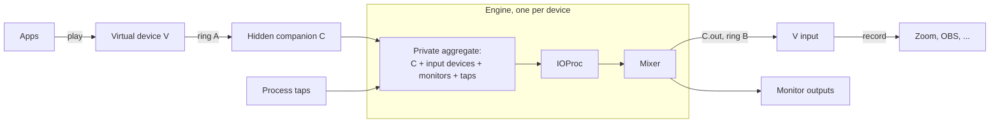

# Architecture

| Part | Role |
|------|------|
| `crates/sr-core` | Pure Rust: config, validation, mixer, meters, `Backend` trait, driver protocol. |
| `crates/sr-audio` | CoreAudio engine: taps, aggregates, IOProc, driver control client. |
| `crates/sr-cli` | Headless tool over the engine. |
| `driver` | AudioServerPlugIn cdylib (`SoundRouter.driver`). |
| `app` | eframe/egui GUI; talks to a `Backend` on a worker thread. |

## Companion-device design

For each virtual device V (what apps pick) the driver also publishes a hidden companion C (uid = V's uid + `COMPANION_SUFFIX`, `.engine`). Two rings connect them:

- V.out -> ring A -> C.in: what apps play into V.
- C.out -> ring B -> V.in: what apps record from V.

The engine uses C, never V, so it can read the apps' mix and write the routed mix without feeding back into itself. While no client runs I/O on C (engine not attached), V's input reads ring A instead, so apps that play into V hear themselves on V's input (Soundflower-style); once C runs, V's input is ring B. The switch is decided per I/O cycle from C's client count.

### Volume and mute on V

V (not C) publishes a volume and a mute control on each scope (4 control objects per slot, listed in `ControlList` and `OwnedObjects`; ids start at `CTRL_BASE`, after the device/stream ids). Volume is a `'vlme'` level control with a -64..0 dB range; scalar is linear in dB (0 -> -64 dB, 1 -> 0 dB, i.e. `convert` is exact and reversible) and the bottom of the range is exact silence. Defaults are 0 dB, unmuted; a slot reused for a new device resets them. Values are not persisted.

The gain is applied when reading, in `do_io`, from one precomputed `f32` per scope (the dB-to-gain conversion runs on the property-set path, so the real-time path does one atomic load and one multiply, no allocation). Samples are stored in the rings untouched:

| Read | Gain |
|---|---|
| C.in (engine, ring A) | V output level |
| V.in, C idle (direct loop, ring A) | V output level x V input level |
| V.in, engine running (ring B) | V input level |

Unity (0 dB, unmuted) skips the multiply, so the default path stays bit-exact; mute writes exact zeros. C has no controls and no gain.

### Overload counter

`WriteMix` calls that arrive late (scheduled before the device's current sample time) or larger than half the ring are counted per device in a relaxed atomic (no logging on the real-time path). The count is exposed read-only as custom property `'srov'` (CFNumber, 64-bit) on V and on C and resets when the slot is reused. Late writes are still written.

### Clock and zero timestamps

V and C of a slot share one timeline: the same `anchor` (set when the first client on either side starts) and the same `seed`, and the same `ClockDomain`. Each device then derives its sample time from its *own* nominal rate (`GetZeroTimeStamp` must stay consistent with the rate the HAL configured on that device, so a 96 kHz V cannot report 48 kHz-period timestamps). Consequence: V and C report identical zero timestamps exactly while their rates agree. They differ only while a rate change has landed on one side; the driver asks both devices to follow, and until both do the pair is silent (`Slot::in_sync`). Tests: `v_and_c_report_identical_zero_timestamps_at_one_rate` (identical at one rate), `zero_timestamp_uses_the_devices_own_rate` (diverge at different rates), and the fakehost zero-timestamp check.

### Default-device flags

- V: `CanBeDefaultDevice` = 1 (both scopes; users and apps choose it as input/output), `CanBeDefaultSystemDevice` = 0. Alerts and sound effects should not be swallowed by a loopback nobody may be listening to; choosing V as the system device in Sound settings is left out on purpose.
- C: both 0, and C is hidden: it is the engine's private endpoint and must never become a default or appear in pickers.

## Aggregate, IOProc, mixer

Per enabled virtual device the engine builds a private aggregate: the companion is the clock source; input devices and monitors join with drift compensation; each app source adds a process tap. One IOProc reads all input buffers (subdevices in list order, then taps), the mixer applies routing, gain and mute, and it writes C's output plus the monitor outputs. Shape mismatches are counted, not trusted (`layout_inputs`, `check_width`); layouts wider than 64 channels per direction fail the check.

## Control property `srcf`

The app sets a custom property `'srcf'` on the plug-in object (type `'plst'`): a CFArray of `{uid, name, channels}`, at most 16 entries; every uid must start with `soundrouter:`. Any local process can set the property (the driver does not check the caller), so it validates everything and keeps the list out of other devices' uid namespace; a hostile process can still remove or rename the user's virtual devices, but cannot read audio (the Microphone permission gates their input). The driver diffs the list, adds or removes devices at runtime (no coreaudiod restart), requests configuration changes for channel changes, and persists the list through host storage so devices survive reboot. A second read-only property reports the protocol version. See `crates/sr-core/src/driver_proto.rs`, `sr-audio/src/driver.rs`.

## Threading rules

- IOProc (realtime): no allocation, locks, logging or ObjC. State arrives through atomics and a newest-plan mailbox; a test asserts the mixer does not allocate.
- `AudioDeviceStart` can block on the TCC prompt, so it runs on a starter thread; dropping a device joins that thread first, and `retire()` keeps callers from blocking.
- GUI thread never touches CoreAudio: a worker thread owns the backend and posts status and meters back.
- Driver entry points abort on panic and never block on the audio path.
